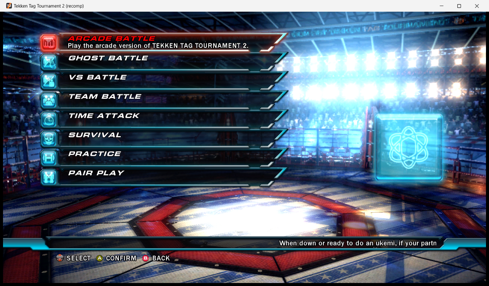
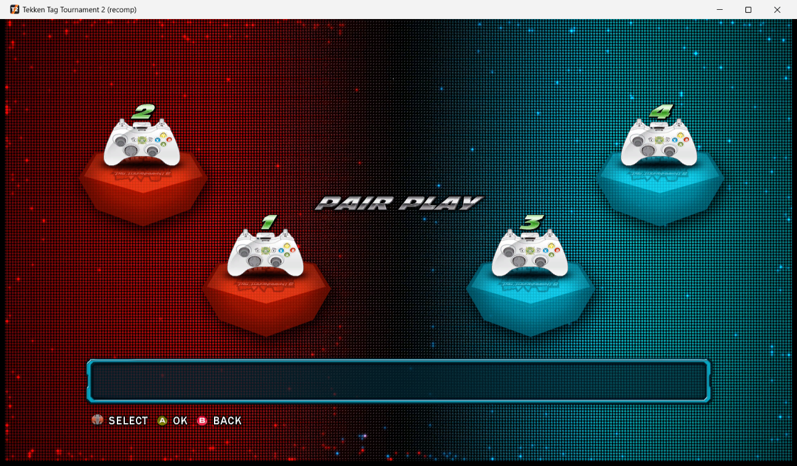
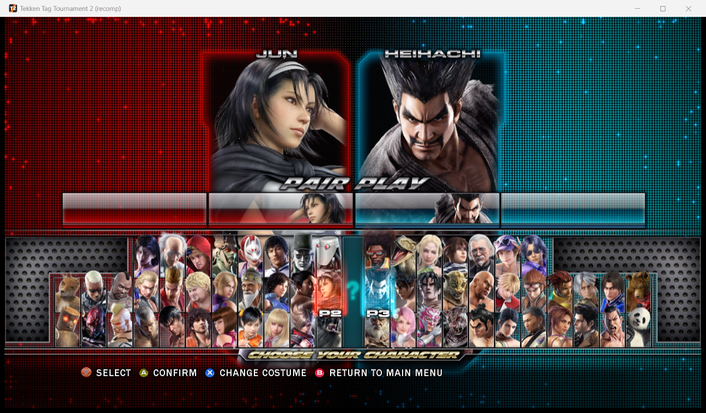
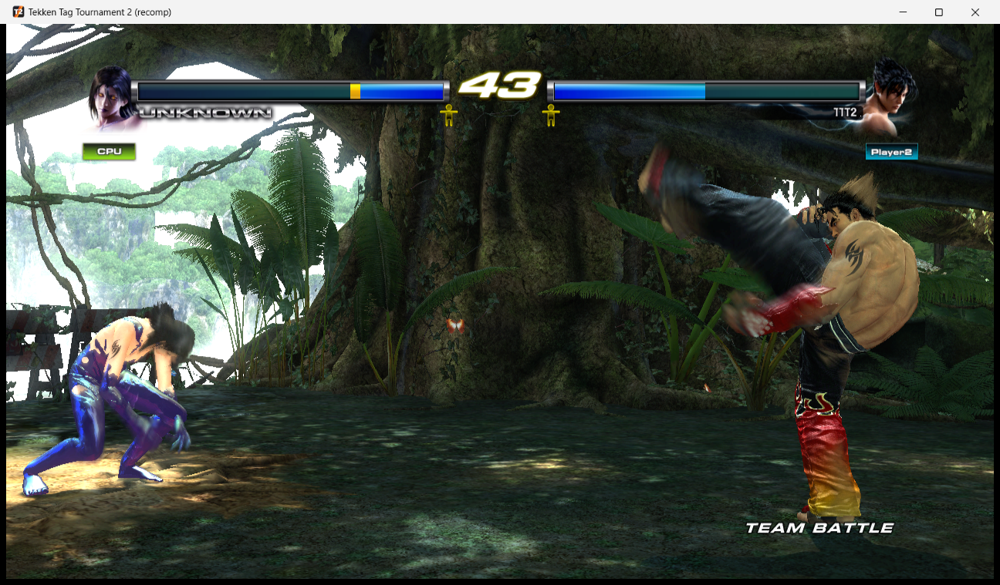
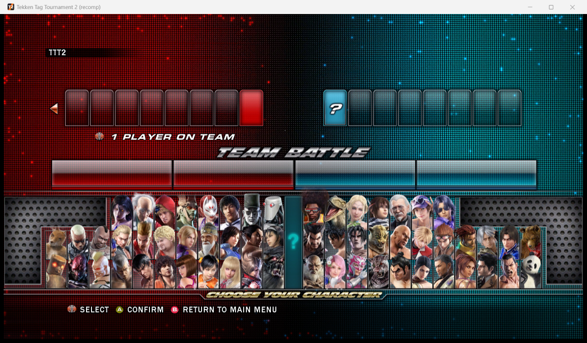

# 🥊 TTT2 Local Lounge — Four Players, One Laptop, Zero Internet

> **Tekken Tag Tournament 2** on a single Windows gaming laptop, shown on the TV,
> with **four smartphones as wireless controllers** over your home Wi-Fi.
> No Steam. No internet. No second PC. Real tag-team Tekken in the living room.

   

---

## 📖 What's inside

| Section | What it covers |
|---|---|
| [⚡ Step-by-step setup](#-step-by-step-from-zero-to-a-2v2-match) | **Start here** — 10 numbered steps from nothing to a 4-player match |
| [🎮 The controller](#-the-controller) | Every button explained |
| [⚔️ Other modes](#%EF%B8%8F-other-modes) | VS Battle (1v1) & Team Battle (up to 8) — step by step |
| [🌐 Advanced: true 4-fighter 2v2](#-advanced-true-4-fighter-2v2) | Online PAIR PLAY on loopback |
| [🛠️ Troubleshooting](#%EF%B8%8F-troubleshooting) | Fixes for the common stuff |
| [📚 Project docs](#-project-docs) | Architecture, plan, test logs |

---

# ⚡ Step-by-step: from zero to a 2v2 match

Do these once in order. Every step is short and verified.

### ✅ Step 1 — Put your game files in place (first time only)
1. Create the folder `C:\TEKKEN\game_files`.
2. Copy in **your own legally obtained** TTT2 disc image (`.iso`) and the
   **Title Update 3** package.
3. Run the port's `ttt2_setup.exe` once to build the game.
   *(The dashboard at Step 3 will show your files with green sizes when this is done.)*

### 🖥️ Step 2 — Start the server (every session)
1. Double-click **`C:\TEKKEN\console\start_server.bat`**.
2. Wait for `bridge: 4 virtual Xbox 360 pads ready` in the window.
3. The dashboard opens automatically at **`http://localhost:8000`** —
   keep this window open while you play.

### 📱 Step 3 — Connect the four phones (every session)
All phones must be on the **same home Wi-Fi** as the laptop. On each phone,
open its link — or faster: open `http://<LAPTOP-IP>:8000` on one phone and
scan the QR codes shown on the dashboard for the rest.

| Phone | Open this | Player |
|---|---|---|
| 1 | `http://<LAPTOP-IP>:8000/player1` | **P1** — red team |
| 2 | `http://<LAPTOP-IP>:8000/player2` | **P2** — red team |
| 3 | `http://<LAPTOP-IP>:8000/player3` | **P3** — blue team |
| 4 | `http://<LAPTOP-IP>:8000/player4` | **P4** — blue team |

1. Rotate each phone to **landscape** and tap the **fullscreen** button.
2. Check the dashboard: all four cards should now say **● connected**.
   (The `<LAPTOP-IP>` is printed in the server window and on the dashboard URLs.)

### 🎮 Step 4 — Start the game (every session)
1. On the dashboard, press **Start game** (the exe path is already filled in).
2. The game window opens — put it on the **TV** via HDMI.

### 🕹️ Step 5 — Claim the pads at the title screen
> ⚠️ **Golden rule: pads are claimed in first-press order.** Whoever presses a
> button first becomes Player 1, the next press becomes Player 2, and so on.

1. **P1 presses START first.** (If an auto-save notice appears, P1 presses **A**.)
2. Then each other player may press their buttons when instructed below.

### 🧭 Step 6 — Enter OFFLINE MODE → PAIR PLAY
1. On the main menu, select **OFFLINE MODE** (press **A**).
2. Move down to the **last row: PAIR PLAY** and press **A**.

### 🪨 Step 7 — Seat all four players on the stones
The PAIR PLAY screen shows **four stones**: two red (left), two blue (right).
Each player joins **in player order** — one at a time:

1. **P1**: press **START** → move **LEFT/RIGHT** to a red stone → press **A**.
2. A dialog appears: *"Exiting player select. Continue anyway?"* — this is
   **normal**: press **A (OK) to advance**. (B = cancel.)
3. **P2**: press **START** → move to the other red stone → **A**, then **A** on the dialog.
4. **P3**: press **START** → move to a blue stone → **A**, then **A** on the dialog.
5. **P4**: press **START** → move to the last blue stone → **A**, then **A** on the dialog.

*Red team: P1 + P2 · Blue team: P3 + P4*

### 🥋 Step 8 — Character select → fight!
1. Press **A** to leave the stones.
2. In the current build **one picker per side** drives the select:
   **P2 picks for red**, **P3 picks for blue** (the portraits update live).
3. Confirm both fighters — the match begins: a genuine **2v2 tag battle**.
   **TAG (LB/RB)** brings your teammate in!

### 🔄 Step 9 — Play again or back out
1. After a match, follow the on-screen prompts (A = continue / rematch).
2. To leave PAIR PLAY: a picker pad presses **B** → confirm with **A** on the
   dialog → back to the main menu.

### 🛑 Step 10 — Shut down cleanly
1. Quit the game from its own menu (closing the window mid-save is not advised).
2. Close the server window (`start_server.bat`) — the four virtual pads disappear.

---

## 🎮 The controller

| Control | In menus | In fight |
|---|---|---|
| **D-PAD / NUB** | move the cursor | move / crouch / jump |
| **A** | ✅ confirm / OK | left punch (default) |
| **B** | ↩️ back / cancel | right punch |
| **X** | — | left kick |
| **Y** | — | right kick |
| **LB / RB** | — | tags |
| **TAG** | — | tag your teammate in! 🔄 |
| **START** | ✅ join / pause | pause |
| **BACK** | select / random team | — |

> The mapping is the classic Tekken layout and stays faithful to the original game —
> combos, walls, rage, tag assaults all work exactly as on console.

**Phone tips:**
- If a phone drops, the server instantly releases that pad's buttons — reopen the
  same URL to reclaim the same slot.
- **Layout editor:** press ✏️ on the controller to drag buttons, resize, and change
  gap. Layouts auto-save per player.

---

## ⚔️ Other modes

### VS BATTLE — classic 1v1 (step by step)
1. Main menu → **OFFLINE MODE** → **VS BATTLE**.
2. P1 and P2 each pick a character (two humans, one character each).
3. Fight — the original two-player mode, untouched.

### TEAM BATTLE — up to 8 characters per side (step by step)
1. Main menu → **OFFLINE MODE** → **TEAM BATTLE**.
2. **P1 presses START** and seats on red; other local pads' START is ignored here —
   one human per side, the other side is CPU.
3. On the team-size row, press **LEFT/RIGHT** to set **1–8 characters per team**
   (e.g. *"2 PLAYERS ON TEAM"*), then press **A**.
4. Pick your team's characters and fight the elimination.
5. **BACK (Select) = random team** — instant fun.

### Single-player modes
ARCADE, GHOST, TIME ATTACK, SURVIVAL, PRACTICE, FIGHT LAB — all untouched and
fully playable with P1's phone.

---

## 🌐 Advanced: true 4-fighter 2v2

The **online PAIR PLAY** room gives every human their own fighter (not shared
tag control) — the game itself says *"team up with friends, each on their own
PC"*. On one laptop we satisfy that with a **second game instance over
loopback** (`TTT2_NET=loopback`, no Steam, no internet):

- **Instance 1** hosts the room → **P1 + P2 = red team** *(tested & working —
  P2 joined locally, picked their own fighter)*
- **Instance 2** (loopback) joins the room → **P3 + P4 = blue team**

Status, caveats and the step-by-step live in
[`IMPLEMENTATION_PLAN.md`](IMPLEMENTATION_PLAN.md) ·
[`ARCHITECTURE_REPORT.md`](ARCHITECTURE_REPORT.md).
For couch play, **offline PAIR PLAY above is the recommended mode today.**

---

## 🛠️ Troubleshooting

| Symptom | Fix |
|---|---|
| Phone page loads forever | Server not running — start `start_server.bat`; check both devices on the same Wi-Fi |
| "denied: slot in use" on a phone | Another tab owns the slot — close it, or press *takeover* on the dashboard |
| A button stuck in-game | Phone dropped while held — the server auto-releases on disconnect; reopen the page |
| P2/P3/P4 don't respond in menus | Pads claim in **first-press order** — P1 must press first at the title; re-order by pressing in sequence |
| The keyboard types into the game | The laptop keyboard is merged into Player 1 — don't type while playing |
| Game window closed by accident | Just relaunch it (dashboard → Start game); the server and phones stay connected |
| Dashboard shows 0/4 phones | Phones not on the same Wi-Fi, or the URL uses the wrong IP — use the exact URL printed in the server window |

---

## 📚 Project docs

| File | Contents |
|---|---|
| [`ARCHITECTURE_REPORT.md`](ARCHITECTURE_REPORT.md) | How the port works, online PAIR PLAY internals, Steam/netcode findings — all file-cited |
| [`IMPLEMENTATION_PLAN.md`](IMPLEMENTATION_PLAN.md) | The phased plan and the fallback architecture |
| [`TESTING.md`](TESTING.md) | Live test log, phase by phase |
| [`DECISIONS.md`](DECISIONS.md) | Every design decision and why |
| [`console/server.py`](console/server.py) | The controller server (FastAPI + ViGEm, 4 slots) |
| [`console/static/controller.html`](console/static/controller.html) | The phone controller page |

**Repository of the game port:**
[github.com/shihabal3amri/tekken-tag-tournament-2-pc](https://github.com/shihabal3amri/tekken-tag-tournament-2-pc)
— this project wraps it with the phone-controller system; the port's own
README covers building it from your own game files.

---

## 🙌 Credits & legal

- Game port by the **tekken-tag-tournament-2-pc** project (XenonRecomp-based).
- Controller system, server and this integration: **TTT2 Local Lounge**.
- You need **your own legally obtained game files** — none are distributed here.
- Play fair, tag often. 🥊
